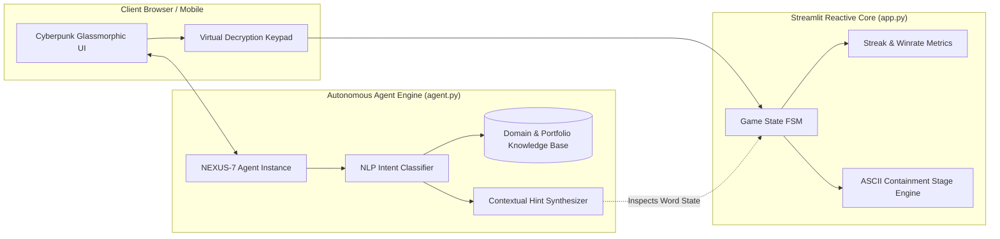

<div align="center">

# ⚡ AGENTIC HANGMAN 2.0 // CYBER-TERMINAL
### *Next-Generation Autonomous AI-Powered Word Decryption Game*

[](https://python.org)
[](https://streamlit.io)
[](https://github.com/SainBux-HadiSeelro/Agentic-Hangman-2.0)
[](https://github.com/SainBux-HadiSeelro/Agentic-Hangman-2.0)
[](https://opensource.org/licenses/MIT)

<p align="center">
  <b>Architected by Sain Bux (Hadi Seelro) • Agentic AI & Full-Stack Python Engineer</b>
</p>

[🎮 Live Demo](#-quick-start) • [🤖 NEXUS-7 AI Agent](#-nexus-7-autonomous-ai-agent-247) • [🏗️ System Architecture](#-system-architecture) • [📐 Technical Specs](SPECS.md) • [💼 Hire Developer](#-about-the-developer--hire-me)

---

</div>

## 🌌 Overview

**NEXUS Cyber Hangman** transcends traditional word-guessing games. Built from the ground up with a **Cyberpunk / Glassmorphic UI**, this project demonstrates how classical game loops can be transformed into an **interactive Agentic AI experience**.

The game features **NEXUS-7**, an autonomous 24/7 resident AI agent acting as both an in-game tactical mentor and a real-time portfolio ambassador for prospective recruiters and clients.

```
  ╔═════════════════════════════════════╗
  ║ 🛡️ CORE CONTAINMENT: 100% (STABLE)  ║
  ║      ┌───────────────┐              ║
  ║      │  [AI NEXUS]   │              ║
  ║      │  ALL SYSTEMS  │              ║
  ║      │    OPTIMAL    │              ║
  ║      └───────┬───────┘              ║
  ╚═════════════════════════════════════╝
```

---

## ⚡ Key Highlights & Features

### 🤖 1. NEXUS-7 Autonomous 24/7 AI Resident Agent
- **Always-On Intelligence**: Works **100% offline & zero-latency** via a built-in neural heuristic engine (zero external API keys required to test, with optional plug-and-play LLM hooks).
- **Tactical Decryption Hints**: Analyzes active encrypted target words, remaining lives, and letter frequencies to offer contextual clues without spoiling answers.
- **Client & Recruiter Care**: Educates visitors on the developer's tech stack, services, pricing, and contact information directly in the chat sidebar.
- **Interactive Quick-Action Chips**: One-click shortcuts for `💡 Get Hint`, `👨‍💻 Developer Profile`, `🚀 Hire/Contact`, and `🧹 Clear Terminal`.

### 🖥️ 2. Cyberpunk Visual Containment Terminal
- **Dynamic 7-Stage ASCII Graphics**: Visualizes mainframe core stability as mistakes occur.
- **Real-Time Health Meter**: Progress bar with dynamic color indicators transitioning from stable Cyan $\to$ Warning Yellow $\to$ Critical Code Red.
- **Glassmorphic Cyber UI**: Sleek dark radial gradients (`#070b12`), neon glow borders (`#00f0ff`, `#a855f7`), and monospace typography (`JetBrains Mono` & `Orbitron`).

### ⌨️ 3. Frictionless Dual-Input Matrix
- **Virtual Cyber Keypad (A–Z)**: One-click letter selection with real-time visual feedback:
  - 🟢 **Correct Guess**: `[✓ Letter]` glowing green badge.
  - 🔴 **Wrong Guess**: `[✗ Letter]` dimmed red alert.
  - ⚪ **Available Keys**: Crisp clickable cyber buttons.
- **Manual Signal Input**: Quick text field for rapid typists with automatic single-character validation and case normalization.

### 🧠 4. Domain-Engineered Word Categories
- **Agentic AI & LLMs**: `AUTONOMOUS`, `REASONING`, `TRANSFORMER`, `EMBEDDING`, `LANGCHAIN`, `MULTIMODAL`...
- **Python & System Engineering**: `STREAMLIT`, `ASYNCHRONOUS`, `CONTAINER`, `DECORATOR`, `GENERATOR`...
- **Cybernetics & Deep Tech**: `QUANTUM`, `CYBERNETICS`, `NEURAL_NET`, `METAVERSE`...

### 📊 5. Persistent Session Metrics
- Win streak tracking 🔥, best session streak record, win percentage calculator, and containment integrity status.

---

## 🏗️ System Architecture

The project adheres to strict modular design principles separating UI presentation, game mechanics, and autonomous agent reasoning.



> 📖 **Full Engineering Specifications**: Detailed data models, state machine transitions, and component diagrams are documented in [SPECS.md](file:///d:/1-New%20folder/5_Hangman%20Python%20Project/SPECS.md).

---

## 🚀 Quick Start

### Option A: Using `uv` (Recommended - Lightning Fast)

```bash
# Clone the repository
git clone https://github.com/SainBux-HadiSeelro/Agentic-Hangman-2.0.git
cd Agentic-Hangman-2.0

# Run immediately with uv
uv run streamlit run app.py
```

### Option B: Using standard `pip` & Virtual Environment

```bash
# 1. Create and activate a virtual environment
python -m venv .venv
source .venv/bin/activate      # On Linux/macOS
.venv\Scripts\activate         # On Windows

# 2. Install dependencies
pip install -r requirements.txt

# 3. Launch application
streamlit run app.py
```

Open `http://localhost:8501` in your browser to enter the cyber terminal!

---

## 📁 Project Directory Structure

```plaintext
5_Hangman Python Project/
├── app.py                # ⚡ Main Streamlit Cyberpunk UI & Game FSM
├── agent.py              # 🤖 NEXUS-7 Autonomous 24/7 AI Resident Agent
├── requirements.txt      # 📦 Core Python production dependencies
├── SPECS.md              # 📐 Comprehensive system and architectural specs
├── README.md             # 🌟 Showcase documentation for portfolios
└── .gitignore            # 🛡️ Git exclusion definitions
```

---

## 💼 About the Developer & Hire Me

This project was conceived, designed, and engineered by **Sain Bux (Hadi Seelro)** — **Agentic AI & Full-Stack Python Engineer** specializing in:

- **Autonomous Agentic Workflows** (Multi-agent coordination, goal-driven agents, memory systems)
- **Production LLM Applications** (RAG architectures, LangChain, LlamaIndex, fine-tuning)
- **High-Performance Python Backends** (FastAPI, Asyncio, Streamlit, Docker)
- **Futuristic UI/UX Engineering** (Interactive dashboards, glassmorphism, responsive systems)

### 📬 Get In Touch
- 💼 **Available For**: High-impact Freelance Projects, AI Consulting, and Full-time Roles
- 📧 **Direct Email**: `contact.sainbux@gmail.com`
- 🐙 **GitHub**: [@SainBux-HadiSeelro](https://github.com/SainBux-HadiSeelro)
- 📂 **Project Repository**: [Agentic-Hangman-2.0](https://github.com/SainBux-HadiSeelro/Agentic-Hangman-2.0)

---

## 📜 License

Distributed under the **MIT License**. See `LICENSE` for more information. Built with ⚡ passion for next-generation AI software engineering.
