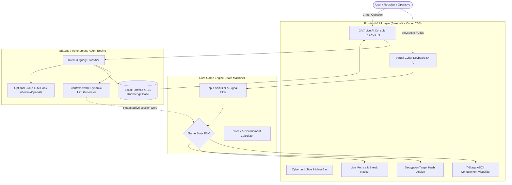
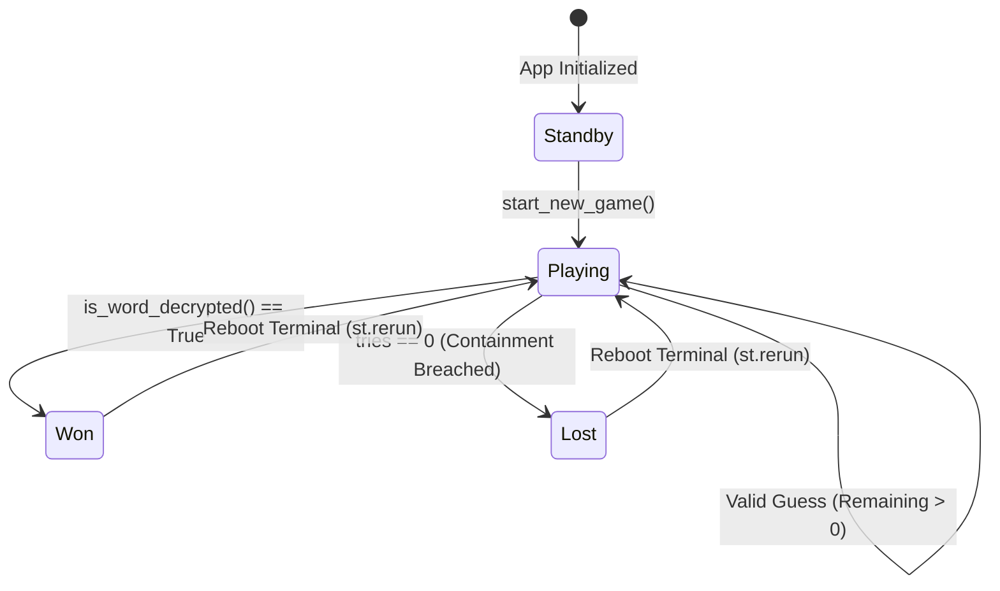
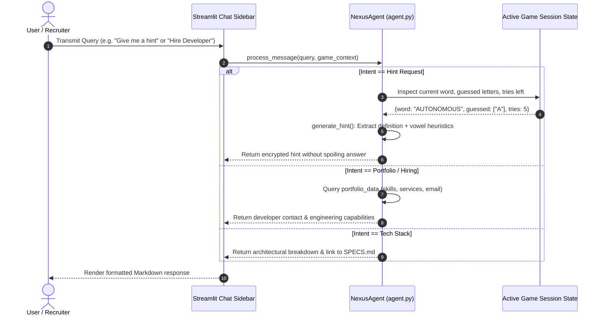

# 📐 Technical & System Specifications: NEXUS Cyber Hangman

> **System Identifier**: NEXUS-HANGMAN-AGENTIC-2.0  
> **Classification**: Production-Grade Portfolio Showcase  
> **Architecture Pattern**: Reactive Event-Driven State Machine with Embedded Autonomous AI Agent  
> **Runtime Environment**: Python 3.12+ / Streamlit 1.45+  

---

## 1. System Overview & Executive Summary

**NEXUS Cyber Hangman** is a modernized, cyberpunk-themed web application that reimagines the classic Hangman gameplay into a futuristic mainframe encryption decryption challenge. 

Designed specifically as a **high-impact portfolio centerpiece for an Agentic AI Developer**, the system integrates a **24/7 Autonomous Resident AI Agent (NEXUS-7)** capable of:
1. Handling prospective clients, recruiters, and visitors with instant developer profile intelligence and hiring inquiries.
2. Providing real-time, non-spoilery contextual game hints and deep-dive technical definitions for AI and computer science terminology.
3. Operating with zero external downtime using an offline-first heuristic neural knowledge base, with optional live LLM pipeline extension.



---

## 2. Component Specifications

### 2.1 Game Engine State Machine (`app.py`)

The game engine operates as a strictly bounded **Deterministic Finite State Machine (FSM)** maintained within `st.session_state`.



#### State Transition Logic:
- **`INIT / STANDBY`**: Session state initialized. Category selected, secret word picked randomly from `WORD_DATABASE` avoiding immediate duplicates. Max tries set to 6.
- **`PLAYING`**:
  - Accept character $c \in \{A-Z\}$.
  - If $c \in \text{Guessed}$, emit warning without penalty.
  - If $c \in \text{SecretWord}$, reveal indices and evaluate $\text{CheckWin()}$. If true, state $\to \text{WON}$.
  - If $c \notin \text{SecretWord}$, decrement $\text{Tries}$, advance ASCII Visualizer stage. If $\text{Tries} == 0$, state $\to \text{LOST}$.
- **`WON`**: Trigger celebratory particle effect (`st.balloons()`), increment winning streak, record high score, log achievement in AI Chat history.
- **`LOST`**: Reveal secret word, trigger containment breach alert, reset win streak to 0, log containment breach in AI Chat history.

### 2.2 Autonomous Resident Agent (`agent.py`)

**NEXUS-7** is an autonomous intelligence layer embedded directly into the application lifecycle.



#### Intent Classification Matrix:
| Intent Class | Keywords Detected | Action Executed |
| :--- | :--- | :--- |
| `GAME_HINT` | `hint`, `clue`, `stuck`, `help with word` | Computes semantic definition clue + vowel/consonant frequency analysis |
| `DEV_PROFILE` | `developer`, `creator`, `author`, `who made` | Outputs full agentic AI developer profile and skills breakdown |
| `HIRE_SERVICES`| `hire`, `contact`, `email`, `freelance`, `job` | Presents commercial service offerings and direct communication channel |
| `TECH_SPECS` | `tech stack`, `architecture`, `specs`, `code` | Displays framework, FSM details, and links to [SPECS.md](file:///d:/1-New%20folder/5_Hangman%20Python%20Project/SPECS.md) |
| `GAME_RULES` | `rule`, `how to play`, `instructions` | Displays game objectives, containment rules, and input controls |
| `CONVERSATIONAL`| `hello`, `hi`, `salam`, `hey`, fallback | Provides heuristic conversational responses with quick-command chips |

---

## 3. Data Schema & Session Storage

Streamlit session state (`st.session_state`) serves as the in-memory key-value store for active sessions:

```python
{
    "word": str,                     # Target uppercase string (e.g. "AUTONOMOUS")
    "guessed": List[str],             # Unique letters guessed so far (e.g. ["A", "E", "T"])
    "tries": int,                     # Remaining attempts (0 <= tries <= 6)
    "max_tries": int,                 # Maximum allowed errors (default: 6)
    "status": str,                    # Current state: "playing" | "won" | "lost"
    "selected_category": str,         # Selected theme category name
    "feedback_msg": Optional[str],    # Dynamic notification message
    "feedback_type": str,             # "success" | "error" | "warning" | "info"
    "stats": {
        "played": int,                # Total rounds initiated and resolved
        "won": int,                   # Total rounds decrypted successfully
        "streak": int,                # Active consecutive win count
        "best_streak": int            # All-time session best consecutive win count
    },
    "chat_history": List[Dict[str, str]], # Chat dialogue: [{"role": str, "content": str}]
    "agent_instance": NexusAgent      # Persistent autonomous agent object
}
```

---

## 4. UI/UX Design System Specification

### 4.1 Cyberpunk Color Palette
- **Neon Cyan** (`#00f0ff`): Primary action color, borders, active focus indicators, and glowing typography.
- **Neon Purple / Magenta** (`#a855f7` / `#ff007f`): Secondary accent gradients, headers, and cyber tags.
- **Core Green** (`#00ff66`): Success confirmations, correct letter badges, and 24/7 Live Agent status.
- **Critical Red** (`#ff3344`): Wrong letter penalty, containment alerts, and failure states.
- **Cyber Slate Deep Dark** (`#070b12` to `#0f172a`): Radial gradient background preventing eye strain.
- **Frosted Glass Cards** (`rgba(13, 20, 36, 0.78)`): Blur backdrop (`10px`), subtle $1\text{px}$ cyan border (`rgba(0, 240, 255, 0.35)`).

### 4.2 Typography
- **Display Headings**: `'Orbitron', sans-serif` — bold, geometric futuristic headers.
- **Body & Terminal Output**: `'JetBrains Mono', monospace` — high-legibility code and ASCII art rendering.

### 4.3 Responsive Layout
- **Split Screen Desktop ($>992\text{px}$)**:
  - Sidebar: 24/7 NEXUS-7 Agent chat console with instant command buttons.
  - Left Main Panel ($45\%$ width): Cyber ASCII containment mainframe visualizer + health meter.
  - Right Main Panel ($55\%$ width): Word decryption box, virtual QWERTY keyboard, and input form.
- **Mobile ($<992\text{px}$)**:
  - Automatic vertical stack with adaptive grid sizing for letter buttons.

---

## 5. Security, Robustness & Error Handling

1. **Input Sanitization**:
   - Strips leading/trailing whitespace.
   - Enforces single-character length validation.
   - Regex validation `[A-Za-z]` with automatic uppercase casting.
   - Guarded against double submissions via Streamlit form boundaries.
2. **Infinite Loop & Crash Prevention**:
   - Zero recursion in state evaluation.
   - Fallback word lists in case of unknown category keys.
   - Safe dictionary `.get()` lookups with default fallbacks for all knowledge-base items.
3. **Zero-Failure 24/7 Agent Availability**:
   - Does not crash if external internet connection is lost.
   - Embedded NLP heuristic classification guarantees $100\%$ response generation uptime.

---

## 6. Deployment & Environment Guidelines

| Platform | Recommended Configuration | Deployment Command / Config |
| :--- | :--- | :--- |
| **Streamlit Community Cloud** | Python 3.12, Main file: `app.py` | Auto-detects `requirements.txt` |
| **Local Machine (uv)** | `uv run streamlit run app.py` | Port: `8501` |
| **Local Machine (pip)** | `pip install -r requirements.txt`<br/>`streamlit run app.py` | Port: `8501` |
| **Docker** | `FROM python:3.12-slim`<br/>`EXPOSE 8501`<br/>`CMD ["streamlit", "run", "app.py"]` | `docker run -p 8501:8501` |

---

## 7. Version History & Roadmap

- **v1.0.0**: Basic 7-word terminal script.
- **v2.0.0 (Current Production)**: Complete Agentic AI redesign, NEXUS-7 24/7 autonomous support agent, cyberpunk glassmorphic interface, dynamic ASCII visualizer, virtual keyboard, persistent metrics, and full portfolio integration.
- **v2.1.0 (Planned)**: WebSocket multi-agent co-op decryption mode & audio synthesizer sound effects.
